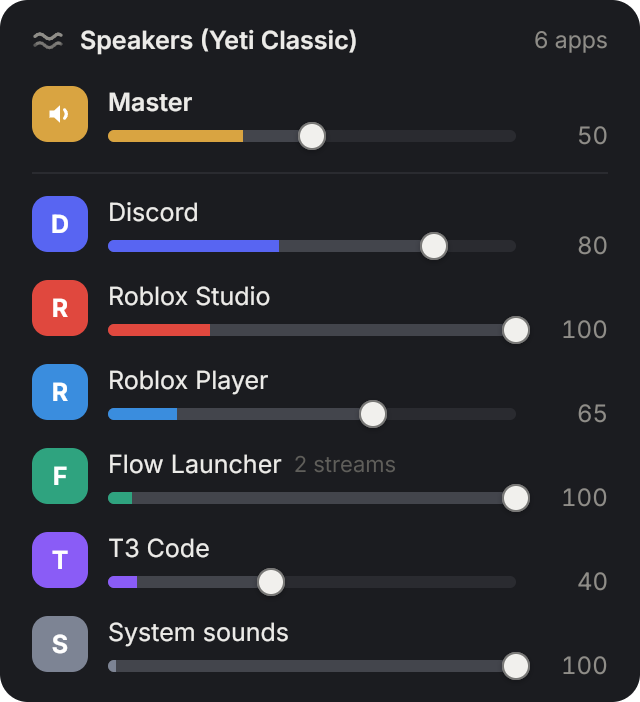

# Tide

Tide is a small volume mixer for Windows. Click its tray icon to set the volume of each app that is playing sound, without opening Settings.



- Press **Win+Alt+V** to open or close the mixer.
- One slider per app, plus master volume for the current output device.
- A live level meter in each slider.
- Click an app's icon to mute it. Scroll over a row to adjust it.
- Follows the Windows light or dark theme.
- Stays idle while the panel is closed.

## Install

Download `Tide-<version>-setup.exe` from the [latest release](https://github.com/Hezaerd/tide/releases/latest). The installer sets up Tide for your Windows account without administrator rights. You can also run `Tide-<version>-portable.exe` directly.

Windows SmartScreen may warn because the builds are unsigned. Choose **More info > Run anyway** to continue.

Windows 11 hides new tray icons. To keep Tide on the taskbar, open **Settings > Personalization > Taskbar > Other system tray icons** and turn on Tide.

## Build

Tide needs Windows 10 or 11 and a stable Rust toolchain.

```sh
cargo build --release
```

The executable is `target/release/tide.exe`.

## License

[MIT](LICENSE)
